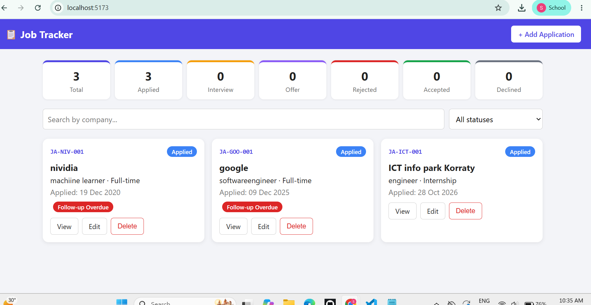
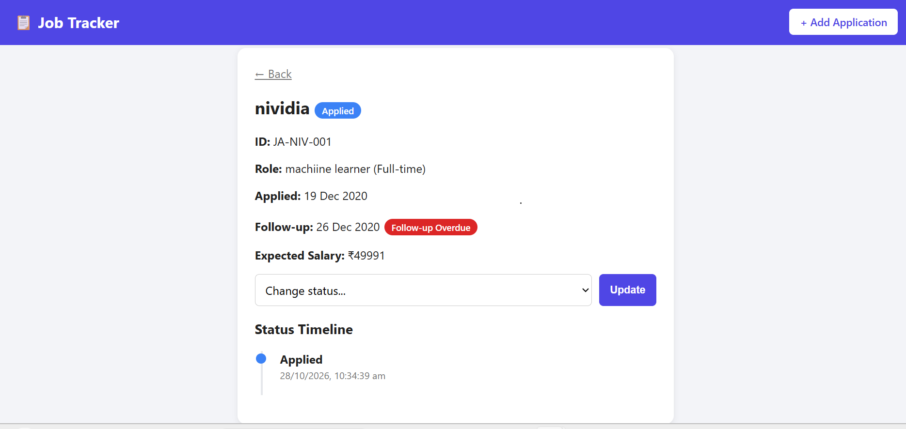

# Job Application Tracker (MERN)

Track job applications through their stages. Built with MongoDB Atlas, Express, React (Vite) and Node.js.

## How to run
1. Open `backend/.env` and set `MONGO_URI` to your MongoDB Atlas connection string (test/dummy database only).
2. Backend:
   ```bash
   cd backend
   npm install
   npm run dev
   ```
   Runs on http://localhost:5000
3. Frontend (new terminal):
   ```bash
   cd frontend
   npm install
   npm run dev
   ```
   Runs on http://localhost:5173

## API list
Base URL: `/api/applications`. All responses use `{ success, message, data }`.

| Method | Endpoint | Description | Status codes |
|---|---|---|---|
| POST | `/` | Create application (validates future date, auto ID, duplicate rule) | 201, 400, 409 |
| GET | `/` | List applications. Query: `status`, `search` (company) | 200 |
| GET | `/stats` | Count of applications per status | 200 |
| GET | `/:id` | Single application with status history and `isOverdue` | 200, 400, 404 |
| PUT | `/:id` | Edit company, role, job type, salary, notes (ID and applied date locked) | 200, 400, 404, 409 |
| PATCH | `/:id/status` | Change status (workflow validated) | 200, 400, 404 |
| DELETE | `/:id` | Delete (blocked for Interview and Offer) | 200, 400, 404 |

## Business rules
- Application ID format: `JA-<first 3 letters of company>-<3 digit sequence per company>`, generated by the backend.
- Status workflow: Applied → Interview/Rejected, Interview → Offer/Rejected, Offer → Accepted/Declined. Rejected, Accepted and Declined are final.
- Follow-up date = applied date + 7 days. `isOverdue` is true if still Applied after that date.
- Duplicate company + role (case-insensitive) is rejected with 409 while the earlier one is active.

## Screenshots


